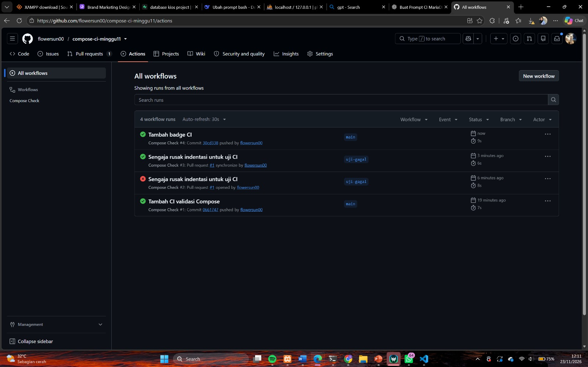
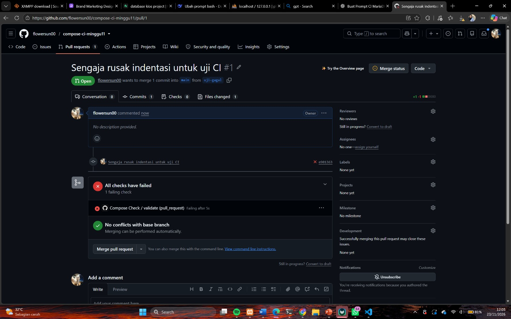
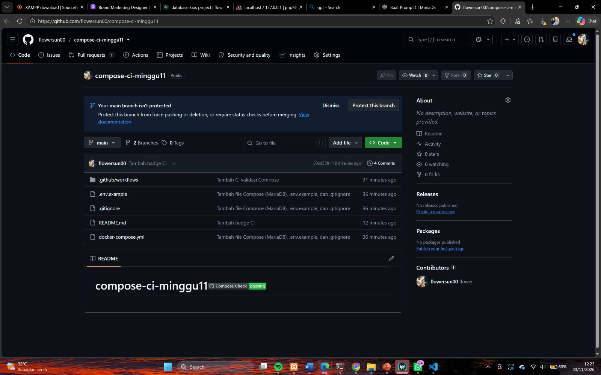

# Tugas Minggu 11: CI untuk Repo Compose

**Nama:** Auliya Paramita
**NIM:** 202557201042
**Mata kuliah:** Teknologi Open Source (TOS)

## Deskripsi
Workflow ini memvalidasi konfigurasi file docker-compose.yml untuk memastikan tidak ada kesalahan sintaks (syntax error) atau indentasi YAML yang rusak. Workflow akan berjalan secara otomatis setiap kali ada aktivitas push atau pull request ke repositori.

## Isi repositori
- .github/workflows/compose-check.yml : workflow CI
- docker-compose.yml : stack WordPress + MariaDB (tugas minggu 10)
- .env.example : contoh variabel lingkungan tanpa rahasia asli
- .gitignore : mengabaikan .env

## Cara kerja workflow
Workflow ini dipicu oleh event push dan pull_request. Terdapat satu job utama, yaitu validate-compose. Job ini terdiri dari tiga langkah (step):

    1. Checkout code: Mengambil kode terbaru dari repositori ke dalam runner.
    2. Setup Docker: Menyiapkan environment Docker agar siap digunakan.
    3. Validasi Compose: Menjalankan perintah docker compose config -q untuk mengecek apakah file YAML valid atau tidak.

## Bukti
1. Run hijau di tab Actions

2. Pull Request dengan check gagal (merah)

3. Badge status di README

Tautan Pull Request (sudah hijau dan di-merge): https://github.com/flowersun00/compose-ci-minggu11/pull/1

## Kendala dan cara mengatasinya
Tidak ada 

## Refleksi singkat
CI sangat membantu dalam mendeteksi kesalahan konfigurasi secara otomatis. Dengan CI, saya tidak perlu menebak-nebak apakah file yang saya buat sudah valid atau belum karena sistem akan langsung memberi tahu jika ada error saat PR dibuat.